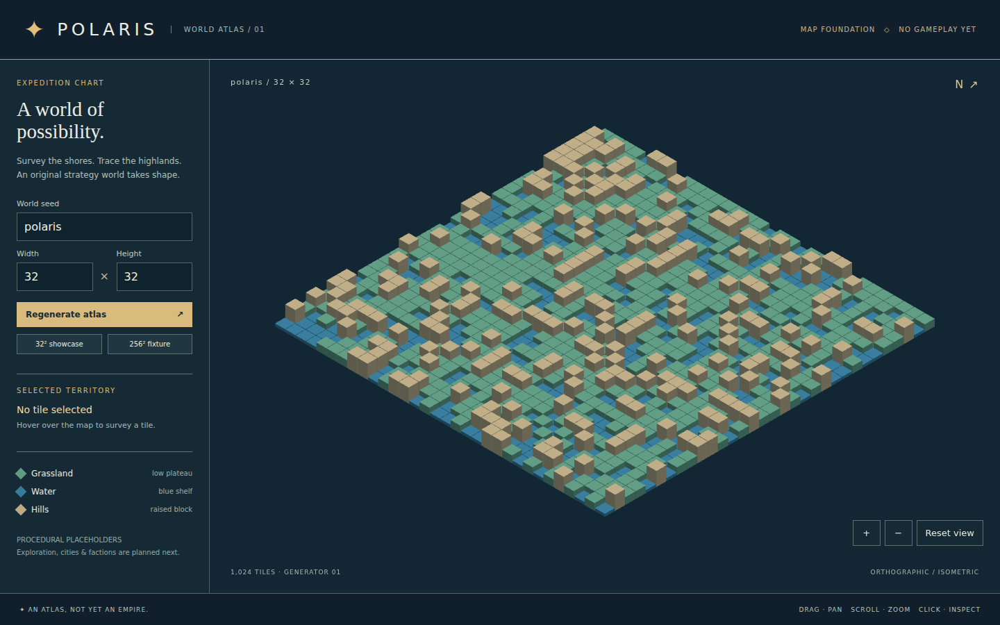
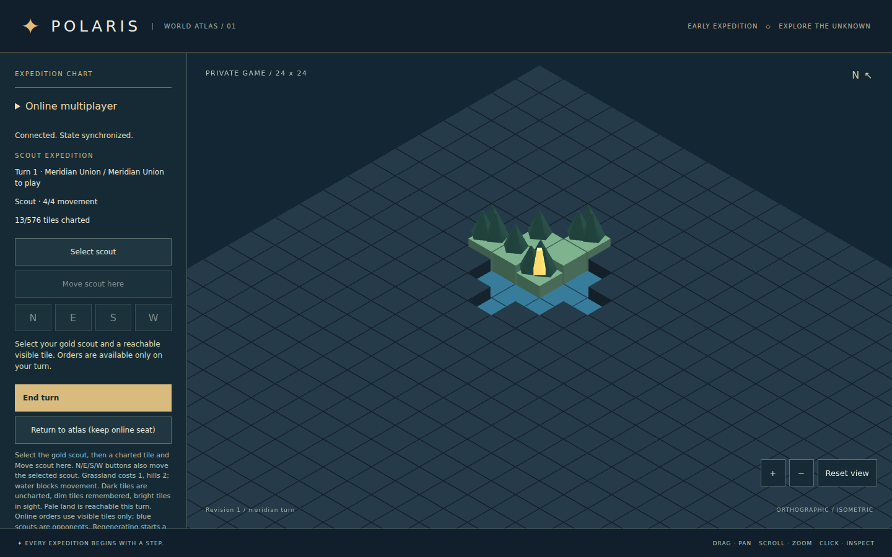
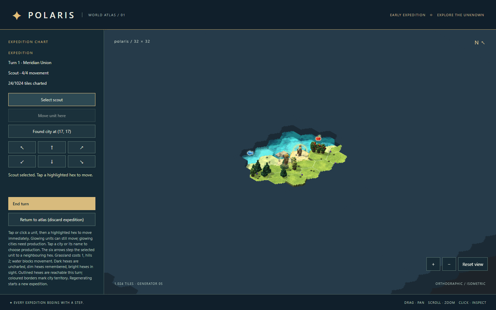
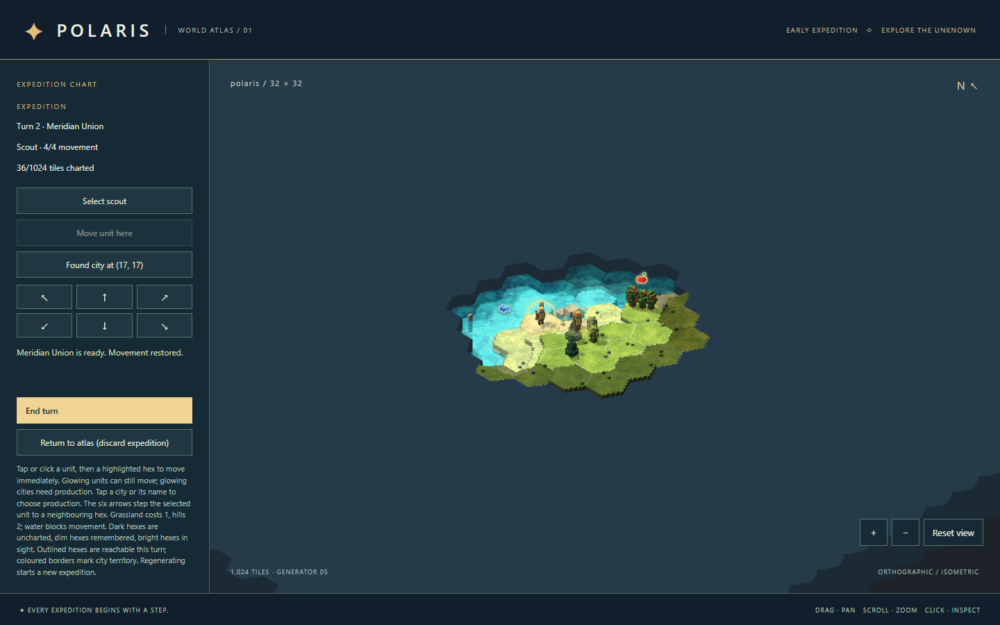

# Polaris · World Atlas & Expeditions

An original voxel-isometric strategy **foundation**, not a complete 4X game. Play local scout expeditions or private, server-authoritative two-player games with alternating turns. The touch-friendly client is an installable Android/iOS **PWA**, with chunked WebGL 2 rendering and an Art Deco HUD.



## Plan and visual direction

- [Game design and planned first playable](docs/game-design.md)
- [Architecture decisions, determinism, and performance targets](docs/architecture.md)
- [Mobile multiplayer architecture, protocol and operating guide](docs/multiplayer-architecture.md)
- [Editable multiplayer architecture diagram](docs/multiplayer-architecture.excalidraw)
- [Dependency-ordered follow-up briefs](docs/roadmap.md)
- [Initial original visual mockup](docs/visual-mockup.svg) — a direction-setting concept, not a rendered screenshot.

**Implemented:** roadmap brief 6 / issue #7, plus private multiplayer rooms, durable turn history, reconnect and a mobile PWA shell. **Next planned gameplay milestone:** brief 7 / issue #8, founding, yields and production. Cities, combat, research, policies, diplomacy, and opponent AI are deliberately deferred.

## Requirements and setup

- **Node.js 24 LTS**, npm 11 (Node 24's bundled npm); other Node majors are not supported by this foundation.
- A current WebGL 2-capable browser: desktop Chromium/Edge, Android Chrome or iOS Safari. Automated browser-engine checks do not certify physical phones or GPU performance.
- No account, runtime CDN or asset-authoring tool is required. Online games require the included Node server; the local atlas works without a backend and offline after the PWA shell has cached.

On Windows, install Node 24, open PowerShell in this checkout, then:

```powershell
npm ci
npm run dev
```

Open the local URL printed by Vite. Run the same commands in a Linux/macOS shell. For a production build:

```powershell
npm run build
npm start
```

Open `http://127.0.0.1:4173`. This serves both `dist/` and the API; SQLite matches persist under `.polaris/` (not committed). For development, run `npm run server` beside `npm run dev`. `npm run preview` is static-only: online play is unavailable there. The current PWA/API deployment supports the origin root, not subdirectory hosting. Public operation requires HTTPS and a durable database volume; see the operating guide above.

## Commands and CI

| Command | Purpose |
| --- | --- |
| `npm ci` | Reproduce the committed dependency tree |
| `npm run dev` | Vite development server |
| `npm run typecheck` | Strict TypeScript checks, including tests/configuration |
| `npm run lint` | ESLint |
| `npm run test:unit` | Vitest, Node-only domain tests; no DOM/Babylon |
| `npm run test:server` | Native Node tests: SQLite, HTTP, authority, retries and redaction |
| `npm run test:e2e` | Playwright desktop/touch Chromium and mobile WebKit against a managed app/API |
| `npm run build` | Type-check, bundle, generate icons and versioned offline shell |
| `npm start` | Serve production app and persistent multiplayer API |
| `npm run server` | Development API on port 3000, proxied by Vite |
| `npm run preview` | Static-only preview; no multiplayer API |

Before the first browser-test run:

```powershell
npx playwright install chromium webkit
```

Linux CI uses `npx playwright install --with-deps chromium webkit`. `.github/workflows/validate.yml` installs Node 24 and runs type-check, lint, domain/server/browser tests and build. No manually started server is needed; stop a server already occupying port 4173 before browser tests.

Headless tests explicitly use Chromium ANGLE **SwiftShader** via `--use-angle=swiftshader --enable-unsafe-swiftshader`. The latter opts into local software WebGL for testing; it is not an app requirement or a rendering bypass. Tests require actual WebGL 2, inspect nonuniform framebuffer pixels, check tile picks, and fail on **every unexpected console error or page error**. GPU performance warnings are not suppressed. Hardware-sensitive FPS is not a CI gate.

Browser runs upload `browser-evidence` (14 days), including screenshots and failure traces; successful runs also upload the built `mobile-app` (7 days). These are actual app captures, not concept art.

## Play together on phones or desktop

1. Use the same HTTPS server URL on both devices. Open **Online multiplayer > Create private game** on the first.
2. Share its private invitation link. On the second device, open the link and choose **Join game**. Each browser gets one seat; two tabs in the same browser share that seat.
3. Meridian starts. Move the gold scout using visible reachable tiles, then **End turn**. Lantern takes the next turn. Blue markers represent visible opponents; hidden terrain, seed and enemy positions never reach the other client.
4. Reload or **Connect / resume** to restore the same device's seat. **Return to atlas** keeps it. **Forget this device's seat** permanently removes access; there is no account recovery.
5. Install via Android Chrome's install menu or iOS Safari's **Share > Add to Home Screen**. Tap selects, drag pans, pinch or buttons zoom. The cached local atlas works offline; online orders do not. An already-sent order with a lost reply is retried using its original ID, never queued as a new offline action.

Rooms have two scouts and no turn deadline, combat or victory yet. They expire after seven inactive days; sessions last 30 days. This is a PWA, **not an App Store/Play Store binary**. Public hosting, signing, native packaging and physical-device release testing remain separate work.

### Verified multiplayer/mobile evidence

[Validation run 42249795653](https://github.com/aschauera/polaris-game/actions/runs/42249795653), application commit `8dff8e0`: **39 domain tests + 10 server tests + 16 browser tests**, type-check, lint and production build. Both mobile Chromium and WebKit exercise two isolated players, turn handoff and reload/resume. Coverage also includes lost-response retries across reload, offline shell loading, static/API cache separation, native Chromium pinch input, phone layout and install icons.

The server suite also passed locally on Windows/Node 24. A CI-built app rendered WebGL 2 and activated its service worker in the Windows integrated Chromium browser. These checks are not physical-phone, store-installation or GPU-performance certification.



[Open the mobile WebKit production screenshot](docs/mobile-multiplayer.png) (390 x 844 CSS viewport, device scale 2). Both captures show server-generated private 24 x 24 worlds; they are actual UI, not mockups.

## Play a scout expedition

1. Generate a world, then choose **Start expedition**. The ordinary atlas stays the default.
2. Select the gold scout on the map or use **Select scout** (also centers the camera).
3. Select a charted destination, inspect its route cost, then choose **Move scout here**. The **N/E/S/W** buttons offer keyboard-accessible single-step orders.
4. The scout has **4 movement points** per turn. Entering grassland costs **1**, hills **2**; water is impassable. There are no diagonal moves, embarkation or combat. The local mode has no opponents.
5. **End turn** restores movement. Invalid orders show a reason and spend neither movement nor RNG state.

Sight reaches two cardinal steps. Uncharted tiles have identical opaque flat surfaces, with terrain/trees hidden and no inspector/pick information. Dim tiles are remembered terrain; bright tiles are currently visible. Pale land is reachable using the current movement budget. Only charted, unoccupied terrain can be used for a route; no hidden-terrain pathfinding. A multi-step move remembers the sight area along its entire route and keeps only the final sight area visible. Static terrain is unchanged between turns.

Regenerating during a local expedition starts a fresh expedition on the new world. Invalid configuration preserves it. **Return to atlas (discard expedition)** removes fog and does not save local progress. Local mode runs one Meridian scout; online mode uses separate faction fog and deterministic turn rotation for two players. Neither mode has AI, faction bonuses, cities or victory conditions.

### Visual overview

Fresh production-app captures from [validation run 42239574200](https://github.com/aschauera/polaris-game/actions/runs/42239574200), application commit `a767df2`, seed `polaris`, 32 × 32, 1440 × 900 viewport, Linux Chromium/SwiftShader:





These are functional UI captures, not concept art or evidence of native-GPU performance. This revision passed **39 unit tests**, **10 browser tests**, type-check, lint and production build in that run.

## Map inputs and controls

- Seed: **1–64 ASCII letters, digits, `_`, or `-`**; case-sensitive.
- Width and height: independent integers **8–256**. Defaults: `polaris`, 32 × 32.
- **Regenerate atlas** repeats exactly the same map for the same inputs and resets camera/selection.
- **256² fixture** loads 65,536 tiles using the current seed; **32² showcase** returns to the small fixture.
- Deep link: `/?seed=polaris&width=256&height=256` (append to the local server URL).
- Click a visible tile to select; hover to inspect. Coordinates are zero-based `(x, z)`; canonical ID is `z * width + x`.
- Left-drag to pan; movement over 5 CSS pixels is a drag, not a selection. Scroll to zoom. Buttons provide zoom/reset.
- With the canvas focused: arrows pan, `+`/`-` zoom, `R` resets. Orientation is fixed; there is no rotation.
- HUD inputs/buttons do not send camera events. Pan target is bounded to map tile centers; zoom is bounded between inspection and whole-map fit. Resize preserves relative zoom.

Generator 2 builds broad, irregular landforms before adding local coast variation, elevation steps and clustered trees. Grassland is a green low plateau, water a blue shelf, and hills a taller sand-colored block; elevation is shown by connected stepped silhouettes, with low-poly canopy clusters for scale. Terrain and tree shapes are original procedural placeholders, not actual volumetric/destructible terrain. Selection/hover outlines are renderer-only data. Invalid inputs leave the prior valid map intact and show an explicit error. Missing WebGL 2 or context loss shows an error rather than a fake successful scene; reload after context loss.

## Validation and benchmark evidence

The automated suite checks complete-map deterministic fingerprints for four seeds, continent separation and stepped elevation, dimensions/bounds and invalid inputs, real rendering/picking after pan/zoom/resize, HUD isolation, regeneration, and unavailable WebGL 2. Expedition coverage adds stable A*/Dijkstra paths, occupancy/costs, rejected commands, faction isolation, fog, actual UI movement/end-turn, hidden-terrain framebuffer/picking checks and mode-transition cleanup. Structural browser checks retain **16 meshes / 7 materials / 16 geometries** for the atlas at 32² and **339 / 7 / 339** for the `polaris` 256² fixture (335 populated chunk/terrain batches): two map-wide tree meshes and two markers, not one object per tile. Expedition mode adds one scout mesh/material/geometry.

Three successive regenerations of **each** size retain those counts. The disposal counter confirms 36 showcase or 1,005 stress source meshes disposed, respectively. `instanceBufferBytes` reports **terrain matrix buffers only** (64 KiB / 4 MiB); it does not include tree matrices, new per-instance RGBA colors (16 bytes per terrain/tree instance), or CPU mirrors. Materials persist across regenerations; full teardown disposes scene/engine, buffers, instrumentation, and listeners. Stable resource counts demonstrate bounded scene resources, **not** a proof of absence of every browser/driver memory leak.

Use the revision's GitHub Actions checks for current type-check, lint, domain/browser test and production-build results. The historical map-only validation had 20 unit tests and 5 browser tests; those regression checks remain alongside the new expedition coverage. The historical benchmark below is not an expedition performance measurement.

Measured results and reproduction details are recorded below. Architecture budgets are provisional targets, not acceptance claims for arbitrary hardware.

### Measured runner sample · 2026-11-05

[Raw measurements, including all 120 frame intervals per fixture](docs/benchmark.json). Production build at commit `2ab5ae7`; seed `polaris`, generator 1, Chromium **156.0.8078.4**, Linux **7.0.0-1017-azure**, Intel Xeon Platinum 8573C, 4 logical CPUs, 15.61 GiB RAM. Headless ANGLE/Vulkan **SwiftShader (Subzero)**, 1440 × 900 viewport, DPR 1; no physical GPU or controlled power profile. Another software-rendered browser was active during part of this sample, so CPU contention is a confounder.

| Actual measurement | 32 × 32 | 256 × 256 |
| --- | ---: | ---: |
| First generation / scene setup, ms | 1.1 / 111.4 | 9.8 / 375.9 |
| Five regenerations: generation median / max, ms | 0.3 / 2.5 | 11.4 / 12.1 |
| Five regenerations: scene setup median / max, ms | 11.3 / 13.4 | 355.1 / 3,186.0 |
| Idle frame intervals p50 / p95 / max, ms | 100 / 116.7 / 200 | 1,516.6 / 2,966.6 / 3,499.8 |
| 120-frame sample duration, seconds | 11.75 | 183.98 |
| Whole-map draw calls, markers hidden | 12 | 768 |
| Draw calls after four zoom/pan steps | 12 | 675 |
| Used JS heap snapshot, MiB | 27.21 | 41.87 |
| Estimated terrain vertex/index + matrix buffers, MiB | 0.072 | 4.615 |

**Method:** open each fixture with `?diagnostics=1`, wait two animation frames, record first timings; regenerate five times; warm up ten frames, then record 120 consecutive `requestAnimationFrame` timestamp differences. Percentiles use sorted sample indices 60 and 114 (approximate p50/p95); do not substitute Babylon's CPU-only `frameMs` for wall-clock frame intervals. Then perform four zoom-in/alternating-arrow-pan steps and sample draw calls/heap. Functional picks and three-regeneration disposal checks run separately in the browser suite. No unexpected console/page errors occurred in the benchmark.

Generation timing surrounds only pure `generateMap`; scene setup surrounds renderer construction/rebuilding and **does not measure first GPU presentation or time-to-interactive**. Heap is Chromium's `performance.memory.usedJSHeapSize` with `--enable-precise-memory-info`, a whole-page snapshot, not map-attributable memory or a forced-GC leak measurement. Buffer estimate is `matrix bytes + batch count × (24 vertices × 8 floats × 4 bytes + 36 indices × 2 bytes)`; it excludes driver copies, framebuffer, markers, JS objects, and allocator overhead. This is a lower-bound allocation estimate, not measured VRAM.

**Result and gap:** generation and structural batching work, but software-rendered frame pacing is poor, especially at 256². The fixture accepts pan/zoom/selection but is **not smoothly interactive on this runner**. The provisional frame targets are not met here; neither native GPU performance nor the full architecture benchmark protocol has been established. Follow up with an isolated Windows Chromium/Edge GPU benchmark, then profile vertex/draw cost and assess an overview LOD or chunk-size adjustment before expanding map sizes. A software-renderer result alone does not justify replacing Babylon with another engine.

**Reproduce:** run the validation commands above; then `npm run build` and `npm run preview`. Open either fixture with `&diagnostics=1`. Read-only `window.polarisDiagnostics.stats()`, `.camera()`, `.projectTile(id)` and `.expedition()` expose timing/resource/picking and player-view diagnostics only when explicitly requested. Unknown-tile projection uses the uniform fog surface, not its hidden elevation. `fogUpdates` counts terrain instance updates, allowing tests to prove camera motion does not recompute fog. For the frame sample, run in the browser console after warming up:

```js
const samples = [];
let last = await new Promise(requestAnimationFrame);
for (let i = 0; i < 120; i++) {
  const now = await new Promise(requestAnimationFrame);
  samples.push(now - last);
  last = now;
}
console.log({ samples, stats: window.polarisDiagnostics.stats() });
```

For CI-equivalent software measurements, use the Chromium flags documented above; add `--enable-precise-memory-info` only for heap reporting. Repeat on isolated hardware and report environment changes rather than comparing absolute times without context.

## Known limitations

- Only scout exploration is playable. No cities, economy, combat, research, policies, diplomacy, AI, physics or victory conditions.
- Local mode loses progress on reload. Online rooms persist for two players, but have no accounts/recovery, cross-device transfer, matchmaking, push notifications, saved-game export or horizontal scaling.
- Automated Chromium and WebKit checks are not physical Android/iPhone certification. Native packaging/store publication, hardware performance, long-duration profiling, assistive-technology map navigation and WebGPU remain unvalidated/deferred.
- Continents and tree clusters are seeded procedural shapes, not a climate or hydrology simulation; rivers, bridges and settlements are not yet represented. At full stress-map zoom tiles are intentionally tiny; zoom in to inspect them.
- Thin-instance picking and scene upload remain synchronous; large-map interactions must be profiled before promising larger maps. The 256² fixture is not a finished-game performance promise.
- The recorded SwiftShader 256² frame intervals are seconds, not a smooth-play claim; native GPU validation and focused rendering profiling remain open.
- Babylon's initial bundle is substantial; Vite reports a chunk-size advisory. It is not a build failure. Loading/code-splitting optimization is deferred until measured.

## Dependencies, assets, and licensing

Runtime: Babylon.js (`@babylonjs/core`, Apache-2.0). Tooling: Vite, Vitest, ESLint, typescript-eslint and Node type definitions (MIT); TypeScript and Playwright (Apache-2.0). Exact package versions and transitive license metadata are in `package-lock.json`; full notices/licenses are included in installed packages and must be retained as required when distributing dependencies.

The minimatch override pins a patched release for the lint toolchain's transitive denial-of-service advisory, GHSA-g3hv-75wg-m249. Re-evaluate the override with future lint-tool upgrades; do not silently restore the vulnerable resolution.

All map geometry, CSS, SVG concept art, favicon, and screenshot are original procedural/code-created placeholders. No reference-game code, names, maps, text, music, art, paid assets, generated artwork, or remote fonts are used. System fonts only. Blockbench (cuboid models) and Blender (cleanup/glTF pipeline) are optional future authoring tools, never setup dependencies. No inspector is bundled; use browser developer tools now and verify a development-only inspector integration in a later task.

**No license is selected for Polaris's own source or assets.** That decision belongs to the repository owner; dependency licenses do not license this game.
