# Polaris · World Atlas & Expeditions

An original voxel-isometric strategy **foundation**, not a complete 4X game. The deterministic atlas now includes a playable scout expedition and a first city-economy slice: founding, yields, growth and production, with chunked WebGL 2 rendering and an Art Deco HUD. Two players can also play a match **by messenger**, with no server: each finished turn is a link, code or file that you send through any chat.


*This image predates the voxel renderer and remains the authoritative reference for landforms, composition and map scale. With explicit user approval, the look of the board follows the [hex voxel concept](docs/concept-hex-voxel.jpg): **hex fields built from cubic voxels**, a brighter diorama palette, soft shadows, territory borders, city name plates and voxel unit figures (see the [expedition captures](#visual-overview)). Both references and the binding graphics rules are listed in the [Copilot instructions](.github/copilot-instructions.md#visual-references).*

## Plan and visual direction

- [Complete target game concept (Deutsch)](docs/spielkonzept.md) — world, four tribes, economy, tactics, cities and victory; planned, not implemented.
- [Dependency-ordered implementation plan (Deutsch)](docs/umsetzungsplan.md) — all six open development PRs included as the intended baseline, milestones, acceptance gates and provisional decisions.
- [Implemented game rules and target-design summary](docs/game-design.md)
- [Architecture decisions, determinism, and performance targets](docs/architecture.md)
- [Dependency-ordered follow-up briefs](docs/roadmap.md)
- [Approved hex voxel concept](docs/concept-hex-voxel.jpg) — authoritative for the look of the board.
- [Initial original visual mockup](docs/visual-mockup.svg) — a direction-setting concept, not a rendered screenshot.
- [Copilot instructions](.github/copilot-instructions.md) — binding rules for every agent and contributor: working order through GitHub *blocked by* relationships, keeping docs and guidance in sync, visual references and graphics rules.

**Implemented:** roadmap briefs 6–7 / issues #7–#8, deterministic commands/turns, movement, exploration, founding, city yields, population growth, and production, plus two-player matches played by exchanging turn messages ([Play by messenger](#play-by-messenger)). Combat, worker actions, research, policies, diplomacy, and opponent AI are deliberately deferred.

**Planning baseline:** this documentation builds on the complete cumulative development stack (#20, #21, #22, #24, #29 and draft #31), as requested; their integration into `main` remains a separate action. The next target is a complete **two-human, three-class, three-beacon match**, then the six-resource economy and four distinct tribes. Exact new costs and balance values remain provisional; the current Meridian/Lantern rules and saves are not silently replaced.

## Requirements and setup

- **Node.js 24 LTS**, npm 11 (Node 24's bundled npm); other Node majors are not supported by this foundation.
- Desktop-class current Chromium or Microsoft Edge with **WebGL 2** enabled. Windows is the initial target; this PR's automated evidence is Linux Chromium, not a claim of Windows hardware validation.
- Phone browsers are an early target: portrait/landscape layout and touch gestures are checked in emulated Chromium only. Real Android/iOS devices are not validated.
- No editor, account, backend, GPU-equipped workstation, runtime CDN, or asset-authoring tool is required.

On Windows, install Node 24, open PowerShell in this checkout, then:

```powershell
npm ci
npm run dev
```

Open the local URL printed by Vite. Run the same commands in a Linux/macOS shell. For a production build:

```powershell
npm run build
npm run preview
```

The production deployment uses Azure Container Apps with GitHub continuous
deployment, as described below. Local previews run through an HTTP server, not
by opening `index.html` from disk.

### Trying the phone layout in a desktop browser

Run `npm run dev` (or `npm run preview` after a build), open the URL in Chrome or
Edge, press **F12**, toggle the device toolbar (**Ctrl+Shift+M**) and pick a phone
such as *iPhone 14* or *Pixel 7*. Reload after switching devices so touch emulation
is active.

- **Tap** selects a tile, **one finger** pans and **two fingers** pinch-zoom. The
  **+ / − / Reset view** buttons also work.
- Below 600 px width the map sits above the controls. Expedition buttons use larger
  touch targets; the controls panel scrolls independently.
- Emulation checks layout and input only. It cannot measure real mobile GPU speed,
  iOS Safari behaviour or battery use.

To try a real phone on the same Wi-Fi, run `npm run dev -- --host` and open the
printed *Network* URL on the phone.

Mobile captures of the hex voxel world from a local browser-suite run of branch `klaus/hex-voxel-world`, seed `polaris`, Windows Chromium/SwiftShader with touch emulation (portrait 390 × 844; landscape 844 × 390):

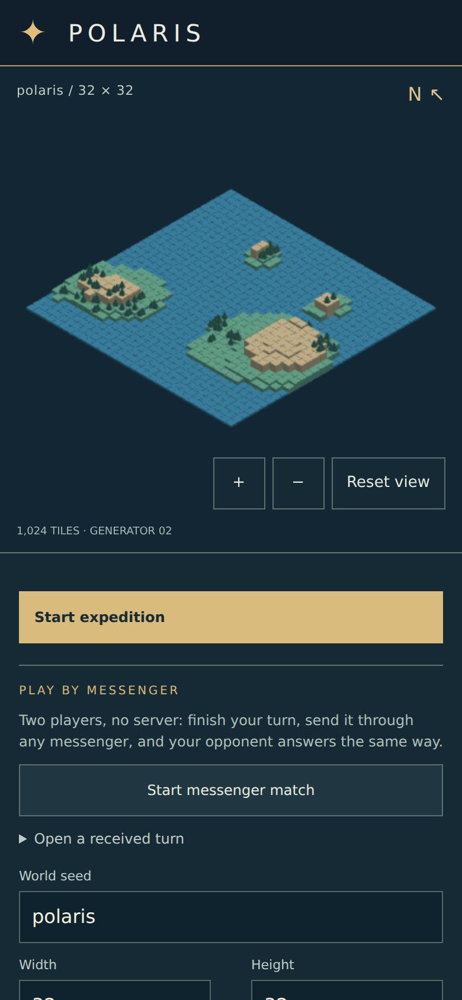

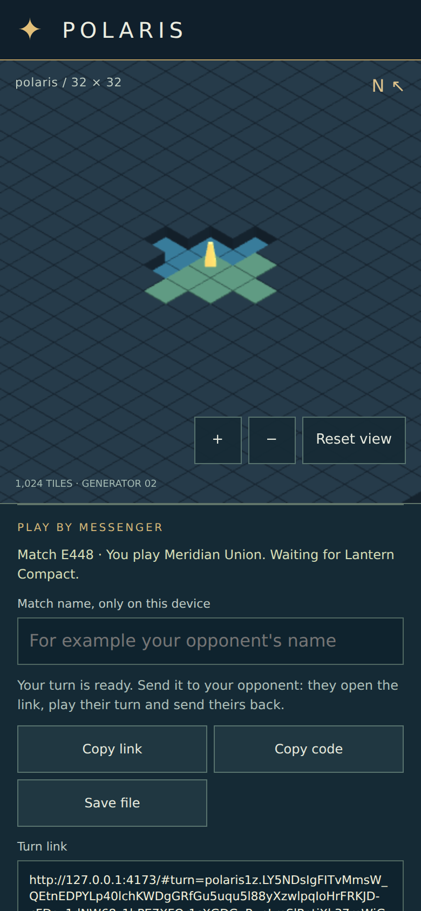

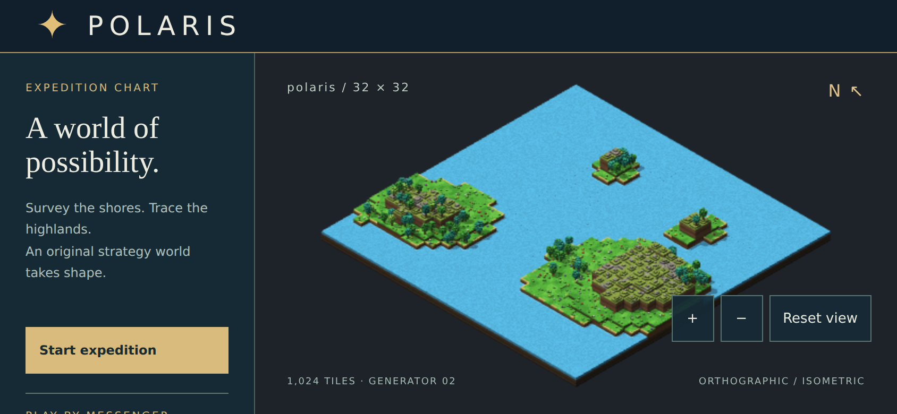

These are emulated browser captures, not evidence from physical iOS/Android devices or mobile GPUs. The run passed **116 unit tests** and **21 browser tests**, plus type-check, lint and production build; the pull request's GitHub Actions run repeats them on Linux.

### Docker and Azure Container Apps

The [Dockerfile](./Dockerfile) builds with Node 24 and the locked dependencies,
then serves the production game using non-root nginx on port **8080**.
`/healthz` returns `ok`; missing assets return 404. Only build inputs are uploaded
to the container build, excluding Git history, local environment files and npm
credentials.

Azure deployment is **setup-only locally**. The scripts provision the app and
configure Azure Container Apps' built-in GitHub continuous deployment. Subsequent
builds and deployments run on GitHub **only when a GitHub release is published**,
not on your workstation or on ordinary branch/tag pushes.
Local Docker and local npm installation are not required for Azure setup.
The Dockerfile and nginx configuration are **GitHub CI build/runtime inputs**,
not a separate local Docker deployment path. Neither setup script runs Docker,
builds in ACR, or deploys a locally built game image.

**Important:** Container Apps' built-in GitHub integration uses GitHub Actions.
Azure CLI automatically creates a workflow in the selected GitHub repository and
configures its secrets. Its generated deployment workflow is maintained in this
checkout with a release-only trigger. The separate foundation validation workflow
runs on pushes and pull requests and is reused as the release deployment gate,
including the offline Azure setup regression tests.

**Prerequisites:** PowerShell 7+, a recent Azure CLI with
`az containerapp github-action` commands, `az login`, permission to create Azure
resources/register providers/assign roles, permission to manage Entra
applications, and GitHub access to write workflows and repository secrets.
Repository branch protection or organization policies can prevent the
integration from creating its workflow. The registry name must be globally
unique, 5-50 lowercase letters/digits. Use a dedicated resource group; resources
incur Azure charges.

1. Commit and push the Dockerfile, nginx configuration, Docker ignore file and
   application sources to the GitHub branch you want to deploy.
2. Run [resource setup](./scripts/setup-container-app.ps1) interactively:

   ```powershell
   az login
   .\scripts\setup-container-app.ps1
   ```

   Each omitted resource name lists existing resources and **`0) (new)`**:
   resource group, ACR, Container Apps environment, Container App, and pull
   managed identity. A new environment also offers existing or new Log Analytics
   workspaces; an existing environment keeps its logging configuration.
   Resource lists are scoped to the chosen group; deployment principals are
   tenant-scoped. The subscription menu lists enabled subscriptions only: creating
   a subscription requires separate account/billing setup and is not offered.
   New resource groups prompt for a region (default `westeurope`).

   This creates or reuses the selected resources and a public HTTPS app
   (new-name default `polaris`). A new app initially
   runs Microsoft's **placeholder**, not the game. Rerunning resource setup
   preserves an existing app's image and ingress port.

3. Run [GitHub deployment setup](./scripts/setup-github-deployment.ps1):

   ```powershell
   .\scripts\setup-github-deployment.ps1
   ```

   Select the same subscription, group, registry and app. These resource menus
   also include **(new)**; selecting a new registry or app runs resource setup.
   Select an existing GitHub deployment service principal or **(new)**.
   Reusing a principal appends a credential and grants deployment roles, so only
   select a dedicated principal you are authorized to configure.
   Follow the interactive GitHub authentication prompt. Azure creates the
   workflow and repository secrets, and the script configures HTTPS ingress for
   nginx port 8080. The generated workflow builds the root Dockerfile and
   publishes the image to ACR. This is a **bootstrap operation**: Azure generates
   a push-triggered workflow and can start an initial deployment. Apply the
   release-only workflow configuration described below before using the app for
   release deployments. Do not rerun bootstrap setup against a release-managed
   app: it can overwrite the release trigger and start a push deployment.
   Check the printed GitHub Actions URL for the bootstrap deployment.
   The app can be unavailable between changing the placeholder's port and the
   first successful game deployment.

Supply a name to bypass its menu (an absent name is created). Optional resource
setup parameters include `-EnvironmentName`, `-PullIdentityName`, and
`-LogAnalyticsWorkspaceName`; GitHub setup accepts `-DeploymentPrincipalName`,
`-RepositoryUrl`, and `-Branch` (defaults to this repository and `main`).
For unattended resource selection, use explicit names and `-NonInteractive`:

```powershell
.\scripts\setup-container-app.ps1 `
  -SubscriptionId '<subscription-id>' `
  -RegistryName '<globally-unique-registry-name>' `
  -ResourceGroup 'polaris-rg' -AppName 'polaris' -NonInteractive

.\scripts\setup-github-deployment.ps1 `
  -SubscriptionId '<subscription-id>' `
  -RegistryName '<globally-unique-registry-name>' `
  -ResourceGroup 'polaris-rg' -AppName 'polaris' -Branch 'main' -NonInteractive
```

`-NonInteractive` suppresses resource menus, not the GitHub authentication prompt.
To reuse an authenticated GitHub CLI account instead of interactive GitHub login,
pass `-UseGitHubCli` to GitHub setup. Its token must be allowed to write repository
workflows and secrets; it is not printed or written to local files.
It requires subscription and registry names and uses documented Polaris defaults
for other omitted names. Both scripts support `-WhatIf` without commands, prompts,
network requests, credentials
or resource changes, and explicitly target the supplied subscription without
changing your Azure CLI default. Entra operations are tenant-scoped; GitHub setup
checks that your active Azure CLI account belongs to the selected subscription's
tenant before managing principals. The app uses 0.25 CPU / 0.5 GiB, single-revision
mode and 0-1 replicas, so the first request after scaling to zero can be slower.

The deployment principal has Contributor on the app and its environment,
Managed Identity Operator on the app's attached pull identities, Reader on the
dedicated group, and push permissions on the registry, rather than subscription-wide
access. Its generated secret is passed directly to Azure's GitHub integration,
not written to local files or printed. ACR admin credentials remain disabled.
Reconfiguring appends a credential to the selected principal to avoid breaking
in-flight deployments. These credentials expire (normally after one year).
For a release-managed app, rotate the principal credential in Entra and update
the Azure/registry credentials in GitHub repository secrets without regenerating
the workflow; remove obsolete credentials after verifying the new ones.
Protect release creation and the default branch: anyone able to publish releases
or modify their build/workflow can use
its deployment privileges. Never run setup with Azure CLI debug logging or a
shell transcript that could capture credential arguments.

**Package source:** GitHub CI builds use the public npm registry by default,
preserving the committed dependency versions. The company proxy was missing
`vite@8.3.6`, `@babylonjs/core@9.34.0`, and `vitest@5.1.0`; it is not used as an
automatic fallback. The Dockerfile's `NPM_REGISTRY` build argument can select
another feed if it contains every locked dependency and is reachable by the
GitHub runner. Configure secure feed authentication separately if needed; do
not embed tokens in source files, Docker build arguments or URLs.

Errors stop setup without deleting resources. Allow new Azure role assignments
to propagate before retrying a failed first workflow run. Inspect build failures
in GitHub Actions and runtime failures with
`az containerapp logs show --name polaris --resource-group polaris-rg`.

### Publishing a game release

The [Azure-generated deployment workflow](./.github/workflows/polaris-AutoDeployTrigger-c3b2f5fd-10fe-45cb-83ab-78817662aa64.yml)
has one trigger: `release` with activity type `published`. Publishing a release
(including a prerelease, or publishing a previously saved draft) validates the
release tag with the full CI suite, then builds that exact tagged source and
deploys it to the Container App. Failed validation prevents Azure login and
deployment. Images use `polaris:release-<GitHub release ID>` so releases have
distinct image names. Deployment runs are serialized for the single production
app without cancelling an in-progress deployment.

Branch pushes and pull requests still run validation. Creating or pushing a tag,
editing a release, saving a draft, or a manual workflow dispatch does **not**
deploy. Publishing a release is an explicit production deployment, including
prereleases; do not publish one just to test the trigger.

**Activation prerequisite:** merge the release workflow and reusable validation
workflow into the repository's default branch (`main`) before publishing. GitHub
only delivers release events to workflows present on the default branch.
Release tags must also contain these workflow changes. No first release is
created automatically, and the running game stays unchanged until publication.

After merging and checking CI, choose a new version and the exact commit:

```powershell
git tag v0.1.0 '<validated-commit-sha>'
git push origin v0.1.0
gh release create v0.1.0 --repo aschauera/polaris-game `
  --verify-tag --title 'Polaris v0.1.0' --generate-notes
```

Use GitHub's **Releases -> Draft a new release -> Publish release** instead if
preferred. The tag push alone does not deploy. Check the **Deploy Polaris release**
Actions run and the game's HTTPS `/healthz` endpoint after publishing. Correct a
failed run and rerun that release run; there is no manual deployment trigger.

Run the scripts' offline tests (mocked Azure, no cloud/GitHub changes):

```powershell
pwsh -File .\scripts\azure-setup.tests.ps1
```

To clean up, disable/remove the generated GitHub workflow and delete only dedicated
deployment resources you created. Never delete a reused principal or shared group.
If the entire group and principal are dedicated to Polaris, remove the dedicated
deployment principal in Entra and then remove **all** resources in that dedicated
group:

```powershell
az group delete --name polaris-rg --subscription '<subscription-id>'
```

## Commands and CI

| Command | Purpose |
| --- | --- |
| `npm ci` | Reproduce the committed dependency tree |
| `npm run dev` | Vite development server |
| `npm run typecheck` | Strict TypeScript checks, including tests/configuration |
| `npm run lint` | ESLint |
| `npm run test:unit` | Vitest, Node-only domain tests; no DOM/Babylon |
| `npm run test:e2e` | Playwright Chromium against a managed production build/server |
| `npm run build` | Type-check and build static production output |
| `npm run preview` | Serve the production output locally |

Before the first browser-test run:

```powershell
npx playwright install chromium
```

Linux CI uses `npx playwright install --with-deps chromium`. `.github/workflows/validate.yml` installs Node 24, runs `npm ci`, type-check, lint, unit tests, browser install, browser tests, and build. No manually started server is needed; stop a server already occupying port 4173 before browser tests.

Headless tests explicitly use Chromium ANGLE **SwiftShader** via `--use-angle=swiftshader --enable-unsafe-swiftshader`. The latter opts into local software WebGL for testing; it is not an app requirement or a rendering bypass. Tests require actual WebGL 2, inspect nonuniform framebuffer pixels, check tile picks, and fail on **every unexpected console error or page error**. GPU performance warnings are not suppressed. Hardware-sensitive FPS is not a CI gate.

Browser runs upload a `browser-evidence` artifact (14-day retention), including a fresh expedition screenshot and any failure traces. These are captures of the implemented app, not concept art.

## Play a scout expedition

1. Generate a world, then choose **Start expedition**. The ordinary atlas stays the default.
2. Tap/click an own unit or its hex, or use **Select scout** to centre the camera on the scout. Its affordable destinations are highlighted.
3. Tap a highlighted destination to move immediately. The six arrows also step the selected unit to a neighbour. Scouts have 4 movement points; founders, guards and workers have 2. A static glow means a unit has a legal move left. No glow means exhausted, blocked, or waiting for the opponent.
4. The scout has **4 movement points** per turn. Entering grassland costs **1**, hills **2**; water is impassable. Every hex has six equally distant neighbours; there is no embarkation, combat or opponent AI yet.
5. **End turn** restores movement. Invalid orders show a reason and spend neither movement nor RNG state.

Sight reaches two hexes around every own unit and city. Uncharted tiles have identical opaque flat surfaces, with terrain/trees hidden and no inspector/pick information. Dim tiles are remembered terrain; bright tiles are currently visible. Pale land is reachable by the selected unit within its budget. Only charted, unoccupied terrain can be used for a route. A multi-step move remembers its route's sight and keeps the combined current sight of all own units and cities visible. Static terrain is unchanged between turns.

Regenerating during an expedition starts a fresh expedition on the new world. Invalid configuration preserves the current expedition. **Return to atlas (discard expedition)** removes fog and returns to free inspection; it does not save progress. The solo expedition runs one Meridian faction without AI, faction bonuses or victory conditions; for two players see [Play by messenger](#play-by-messenger).

### Visual overview

Captures of the hex voxel world from a local browser-suite run of branch `klaus/hex-voxel-world`, seed `polaris`, 32 × 32, 1440 × 900 viewport, Windows Chromium/SwiftShader:


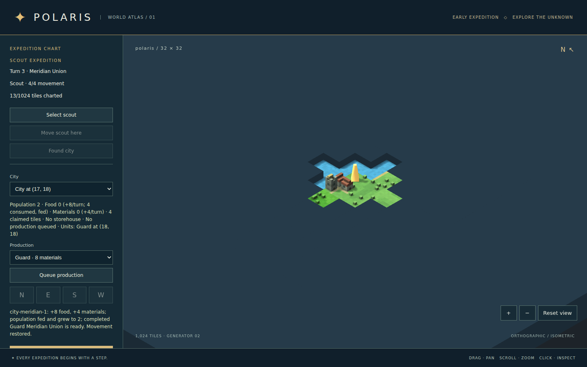

These are functional UI captures, not concept art or evidence of native-GPU performance. This revision passed **116 unit tests**, **21 browser tests**, type-check, lint and production build in that run; the pull request's GitHub Actions run repeats them on Linux.

## Play by messenger

Two people can play one match **without a server, an account or a live connection**. Every finished turn becomes a short text that you send through any chat, e-mail or shared folder. Both devices replay the same ordered orders on the same seeded world, so nothing has to be hosted. This is a first multiplayer step; a relay or live connection can be added later without changing the rules.

1. **Host:** choose a world, then **Start messenger match** in the *Play by messenger* panel. You play **Meridian Union** and move first.
2. Give your orders (move, found a city, queue production), then choose **End turn**. The panel offers the finished turn as a **link**, a **code** and a **file**: **Share** (where the browser offers it), **Copy link**, **Copy code** or **Save file**. Send one of them to your opponent.
3. **Guest:** open the link, or paste the link, the code or the whole chat message under **Open a received turn**, or choose **Open file…**. The match opens as **Lantern Compact** and it is your turn. Reply the same way, and so on.

To try it alone, use two browser profiles or a private window for the second player: matches are stored per browser profile.

How it behaves:

- A message carries the **whole match so far**: seed, size, game versions, every order and two checksums. A late or lost message cannot desync you; open the newest one and the match catches up. A repeated or older message is recognised and leaves the match unchanged.
- Orders are validated by replaying them under the normal rules. A turn is refused if it is damaged or truncated, unfinished (it must end with **End turn**), from another game or rules version, does not continue your saved copy of that match, contains orders for your own side, or replays to different checksums. The reason is shown, and what you pasted stays in the box.
- While your opponent is on turn you can still inspect the map, but orders and **End turn** are disabled. While a match runs, the world inputs and presets are locked and **Return to atlas** is hidden.
- **Several matches at once.** Every message names its match, so a received turn always lands in the right one: it opens that match even while another is on screen, which stays saved. **All matches** returns to the atlas and lists *Your matches*, newest first; matches where it is your turn are marked in gold, and **Continue** opens one. An optional **match name** (for example your opponent's name) is kept on this device only; without one, both players see the same short title such as *Match 38A5*.
- Matches are stored in this browser (`localStorage`, one key per match under `polaris.matches.v1.`) and the last one played reopens after a reload. **Leave match** asks for confirmation and forgets that match on this device only; your opponent keeps theirs. Without storage (some private modes), only the match on screen exists: a turn of another match is refused until you choose **All matches**, and opening your opponent's latest message restores a match. A match saved by an earlier version is moved into the list automatically.
- Links keep the turn in the `#turn=…` fragment, which is never sent to a web server. Short matches fit into one chat message; long ones produce long links, so use **Save file** for chats that cut messages (Telegram: about 4,096 characters). A link created on `localhost` only opens on that machine.

### Limits of a serverless match

- **No anti-cheat.** Both devices know the entire match, so fog of war is a presentation rule here, not a secret, and the checksums detect accidents and desyncs, not a determined opponent. Games that need secrets, simultaneous turns or push notifications need a server.
- Both players must use the same Polaris version. A different rules or generator version is reported instead of silently diverging.
- The current world generator and rules are both **version 4**. Older-generator or older-rule local matches stay saved and listed, but cannot resume in this version; their auto-resume pointer is cleared and the incompatibility is explained. They require a compatible copy of Polaris. No automatic world conversion or deletion is performed.
- The map draws your cities and units, and the opponent's cities and units while you can see them, as voxel figures in faction colours; the HUD lists your own cities and the opponent's orders are applied and checked.
- Two tabs of one browser profile share the stored matches; playing the same match in both overwrites one with the other. Matches live on one device only and are not synchronised between your own devices.
- Chromium desktop and emulated-phone interactions are automated, including two isolated contexts acting as messenger devices. Real iOS/Android browsers and messenger apps still need device validation.

### Visual overview

Captures of the hex voxel world from a local browser-suite run of branch `klaus/hex-voxel-world`, seed `polaris`, 32 × 32, Windows Chromium/SwiftShader. The idle panel and the match list are 1440 × 900; the two device captures are 1100 × 760 and come from two isolated browser contexts of one test:

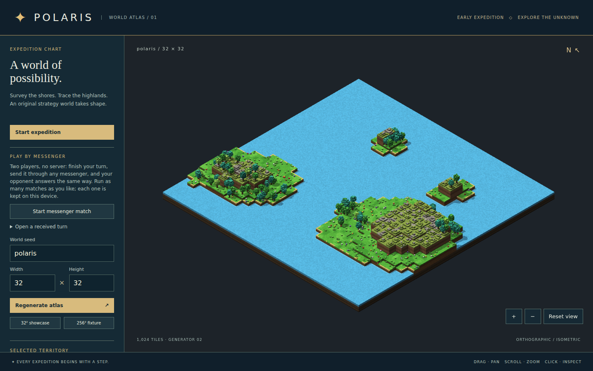

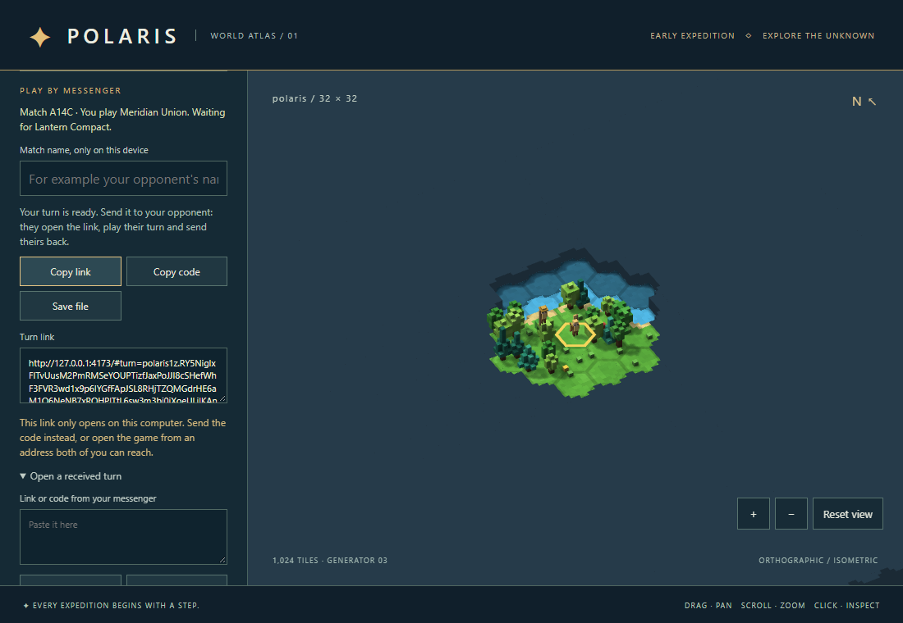

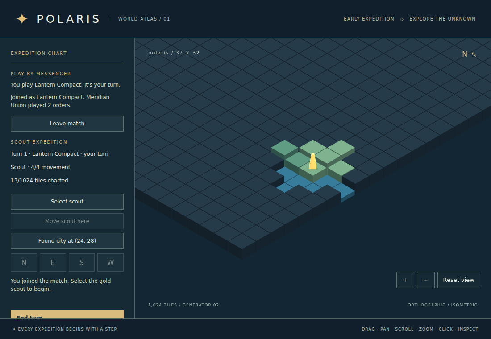

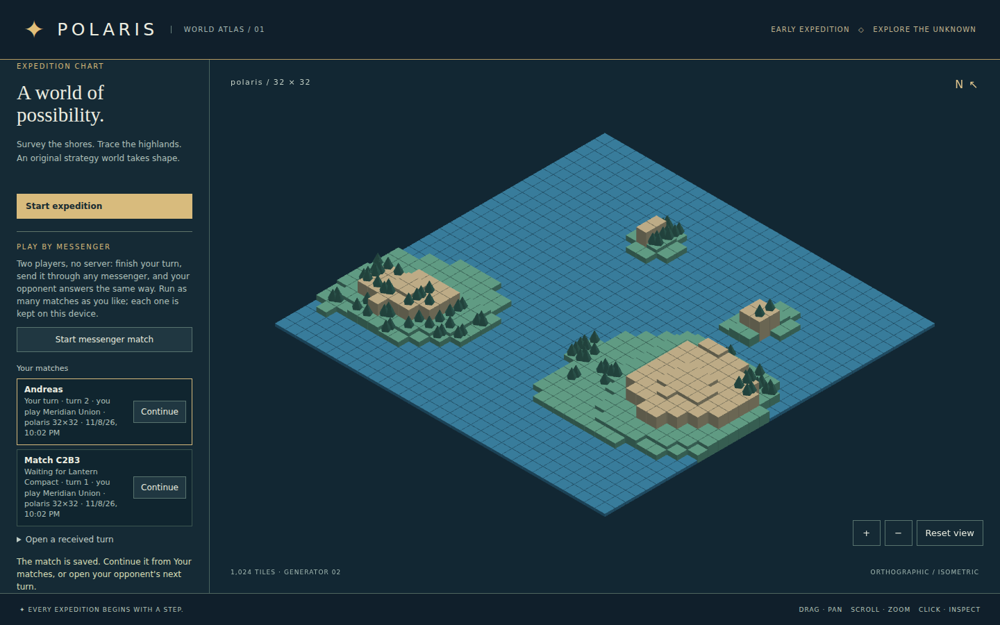

These are functional UI captures, not concept art or evidence of native-GPU performance. This revision passed **116 unit tests**, **21 browser tests**, type-check, lint and production build in that run; the pull request's GitHub Actions run repeats them on Linux.

## Map inputs and controls

- Seed: **1–64 ASCII letters, digits, `_`, or `-`**; case-sensitive.
- Width and height: independent integers **8–256**. Defaults: `polaris`, 32 × 32.
- **Regenerate atlas** repeats exactly the same map for the same inputs and resets camera/selection.
- **256² fixture** loads 65,536 tiles using the current seed; **32² showcase** returns to the small fixture.
- Deep link: `/?seed=polaris&width=256&height=256` (append to the local server URL).
- Click or tap a visible tile to select; hover to inspect. On touch screens one finger pans and two fingers pinch-zoom. Coordinates are zero-based `(x, z)`; canonical ID is `z * width + x`.
- In an expedition, select a unit then tap a highlighted hex to move. Tap a city or its name plate to choose production. Cities with an empty queue glow; queuing removes the glow until production completes. Glows are static, do not add WebGL resources, and are off while waiting for the opponent. Buttons also support keyboard activation.
- Stone, apple and fish occurrences have projected symbols at inspection zoom and names in hover/selection text. They are visual only: harvesting and extra economic yields are not implemented.
- Left-drag to pan; movement over 5 CSS pixels is a drag, not a selection. Scroll to zoom. Buttons provide zoom/reset.
- With the canvas focused: arrows pan, `+`/`-` zoom, `R` resets. Orientation is fixed; there is no rotation.
- HUD inputs/buttons do not send camera events. Pan target is bounded to map tile centers; zoom is bounded between inspection and whole-map fit. Resize preserves relative zoom.

Generator 4 builds broad, irregular landforms on a **hex grid** (pointy-top hexes in odd-r rows), with warped shorelines and deep curved bays cut into the larger islands. These inlets are genuine ocean-connected water tiles, not painted gaps on land. Elevation steps and clustered trees follow the new coastline; the same seed now intentionally produces a different map from generator 3. The renderer builds every hex from square columns of small cubic voxels: **16 voxels across each showcase hex** when both map dimensions are at most 32, then 8 up to 64, 4 up to 128 and 2 above. That doubles the former showcase resolution along each edge and gives roughly four times as many surface cells, as requested to approach the [hex voxel concept](docs/concept-hex-voxel.jpg). Trees, settlement stamps and coast width retain their world-space proportions instead of shrinking. The fixed camera uses yaw 45° and pitch 35.264°: equal projected cube axes with symmetric 30° slopes. This is a geometric calibration of the illustrated reference, not recovered source-camera metadata.

The scene shows yellow-green grass over warm soil and grey stone cliffs, pale sandy beaches, **low connected highlands instead of tall grassy pillars on every hex**, and up to five small round or conifer trees on the back of a hex, plus sparse grass tufts, flowers and stones. Detailed land elevations are **0.625, 0.75, 0.875 and 1 world units** above water at 0.25; coarser voxels merge levels rather than exaggerating their height. Trees are about one third shorter than the earlier pass: at most **0.75 world units**, with narrower crowns. Water has a level translucent surface over **four broad seabed terraces**, not many narrow microsteps, and compact coastal rock groups. Some rocks remain submerged; others rise through shallow water, with exposed grey tops and no water cap drawn through them. Both detailed scales retain the same four world-space floor heights; finer voxels refine their outlines rather than increasing their number. Charted-land distance, warped by deterministic noise, shapes irregular coves; the bottom shifts from cyan-lit sand through patchy stone to deep blue. Separate shallow, shoal, shelf and deep cap colours preserve bright cyan coasts without washing out the blue open sea, using the same transparent material. The cube tops and sides are geometry, not painted bevels on a flat plane; exposed diorama cut walls remain blue and opaque. Thin, visible hex frames now sit on the water cap, never on the seabed. Scale 4 merges unrepresentable depths into three levels; scale 2 omits coastal relief and rocks. Land and underwater terrain appear only where charted during an expedition, and unknown coasts cannot shape visible water or rocks. Faces are greedy-meshed with baked ambient occlusion; opaque and transparent submeshes share each chunk's geometry, without individual cube meshes. A sky fill and a sun with soft shadows light the scene, and the scene is redrawn only when something changes.

**Irregular sandbanks** occupy larger patches of existing land and physically interrupt cliffs. Seeded coastal pockets lower the terrain to sandy tops just above water, with a low inland shelf and sandy side faces; intact cliffs remain between them. They are not painted rims or newly walkable islands on water tiles. Only charted water can shape a bank, whole tree roots stay on their charted tile and off sand, and sparse stones replace grass tufts. Settlements keep their levelled sites and land resources retain dry ground. Actual column heights drive picking, figures, markers and diagnostic projection, so a lowered bank cannot leave an invisible old cliff blocking clicks. Domain terrain, elevation and movement remain unchanged; banks are omitted at the coarsest scale.

**Stone deposits, apple groves and fish shoals** are deterministic presentation occurrences. Hills get broad irregular grey blocks with different flat cap heights, chipped shoulders and occasional rubble, rising at most 0.625 world units above detailed ground while leaving the tile centre free for units. Grassland can carry small round trees with red fruit voxels; water gets a fish symbol. Original inline SVG glyphs use the existing projected city-label layer and share occurrence identity with hover/selection text. Uncharted resources stay hidden, remembered ones are dimmed, and a city replaces its occurrence. Markers are culled to the camera, limited to 128 visible DOM nodes and removed in the overview or on regeneration; they add no WebGL meshes, materials or textures. Resource presentation does not change domain tiles, simulation RNG, movement, messenger packages or the economy; the new island shapes are the separate generator-v4 change. The inspector explicitly states that harvesting is not available.

Terrain and decorations are original procedural placeholders. Cities appear as voxel settlements (a stone keep with a gold Meridian or blue Lantern banner, one to three terracotta-roofed houses as the population grows, and a thatched storehouse once built) with a name plate showing the population and a border in the faction colour around their territory. Scouts, founders, guards and workers are small voxel figures in faction colours; rival units get a red hex ring. The voxels are visual, not destructible or editable terrain. Water picks the level cap or an emerged rock's actual top, never the submerged floor; its canonical terrain remains water and movement rules are unchanged. No dynamic waves, refraction or water physics are implemented. Selection/hover hex outlines are renderer-only data. Invalid inputs leave the prior valid map intact and show an explicit error. Missing WebGL 2 or context loss shows an error rather than a fake successful scene; reload after context loss.

Surface materials add five levels of world-anchored light/dark patches: broader 2-by-2-voxel blue/turquoise shades on the water cap and finer one-voxel shades on grass, sand and rock tops. Fine contrast fades as cells become subpixel, and shoreline variation is softer. This supplements the real underwater geometry rather than painting fake depth. Sparse sun glints animate on visible water caps, with world-anchored square cells and drifting groups of brief highlights. The restrained shimmer blends at most 35% toward the sun colour, down from 85%, and chooses about a third fewer flashes so the blue water and seabed remain prominent. Idle animation frames are at least 80 ms apart (at most about 12.5 fps); shadows and geometry are not rebuilt. Reduced-motion preferences, far overviews and no resident visible water stop the glint tick. Remembered water stays still. No extra image textures, geometry, waves or simulation randomness are introduced. Diagnostics expose `waterGlint` and `renderedFrames`.

The palette is calibrated against the **rendered framebuffer**, including lighting, surface shades and water blending, rather than copying illustration RGB values directly into materials. The concept median targets are RGB **151,171,60** for grass and **11,117,170** for deep water, with an eight-byte per-channel tolerance in unobstructed material samples. These are comparable materials, not a claim that different scenes and shadows are pixel-identical. Both land and water grids are screen-space hairlines: tests require full width at half maximum **0.75–1.5 framebuffer pixels** across three edge directions and two inspection zoom levels, versus **3.5 pixels** with the former broad shader. A negative control disabling water lines measured only 0.58 luminance contrast and failed the >8 presence threshold. Reachable outlines, territory bands and hover/selection rings are also slimmer, while faction colours and interaction meaning stay unchanged.

### Visual overview: coastal rocks, smaller trees and resources

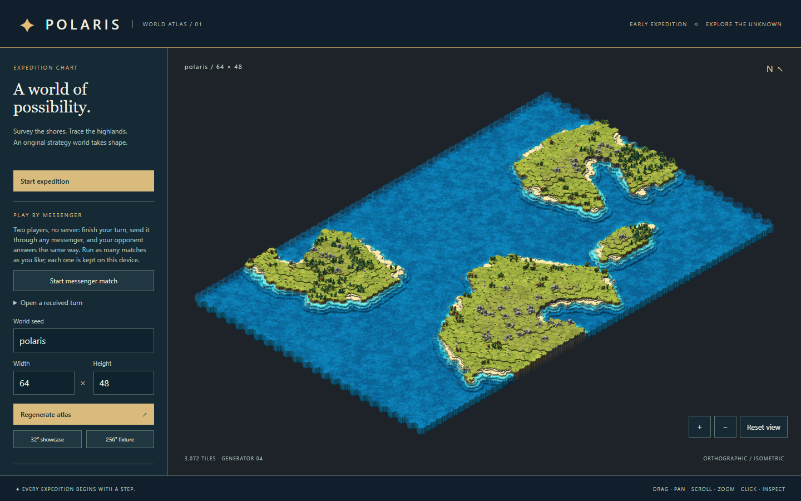

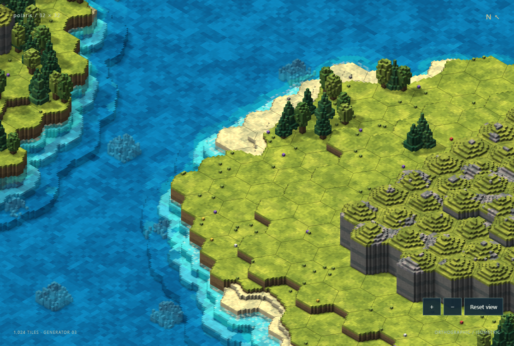

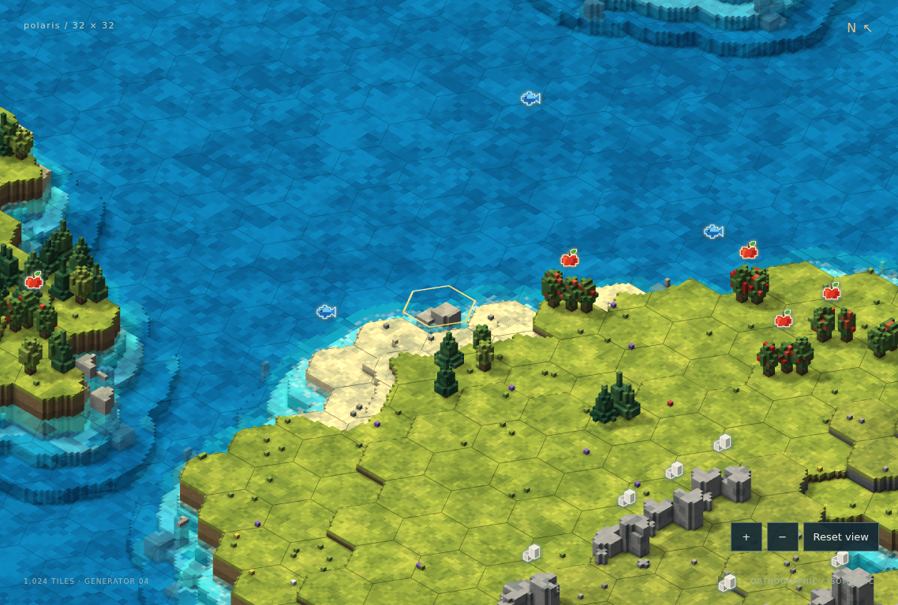

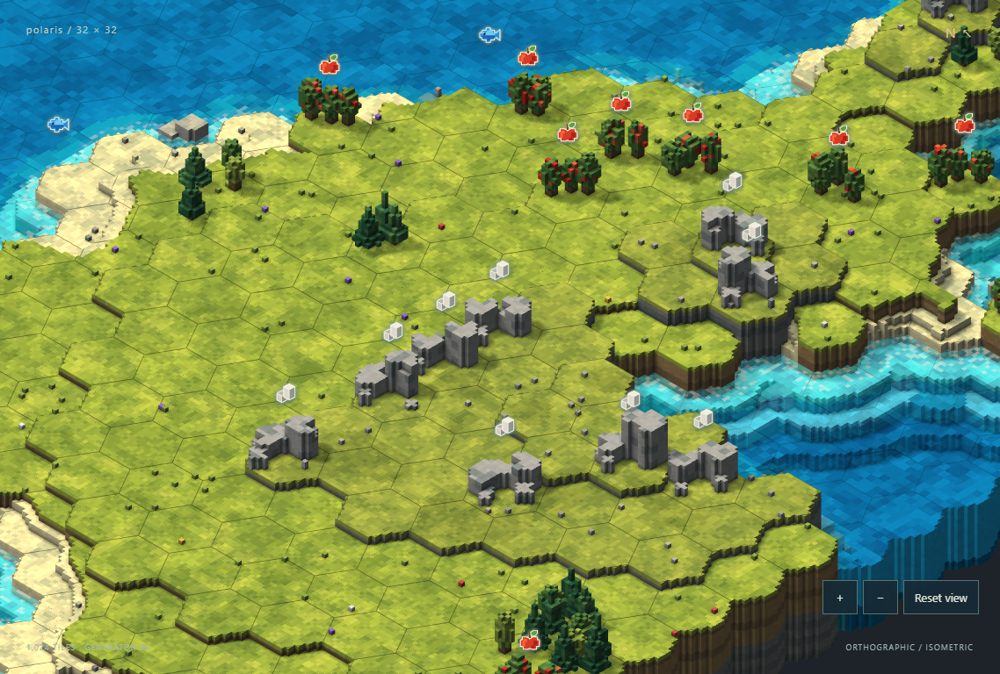

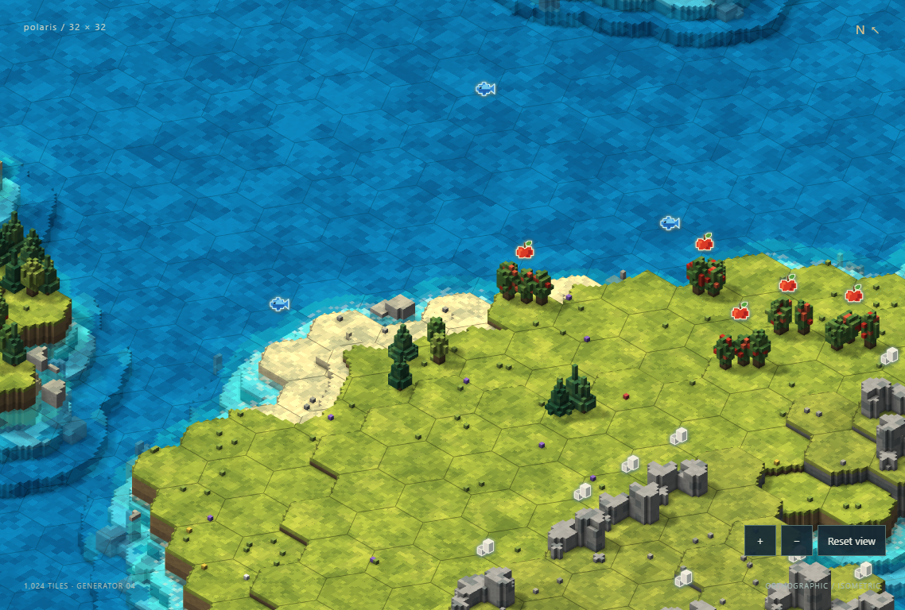

Fresh application captures for the latest draft #31: `polaris`, a 64 × 48 whole-world overview and 32 × 32 canvas details, desktop Chromium/SwiftShader at 1440 × 900, DPR 1. The overview keeps the authoritative reference's map dimensions and broad separated landmasses while showing the new open bays. Low connected highlands replace the per-hex grassy pillars; stone groups have broader caps, varied heights and chipped shoulders. The approved colours, four underwater terraces, sandbanks, smaller trees, isometric camera and voxel densities are retained. These show the implementation, not concept art or a hardware performance benchmark. New regressions measure actual bay depth and connectivity, world-space land heights and coarse merging, rock footprints/caps/centre clearance, canonical bay selection and grey framebuffer geometry. Earlier coast, resource, palette, grid, gameplay and messenger checks remain. Visual acceptance remains part of draft review.

Validation: **146 unit tests and 40 browser regressions**, type-check, lint and production build. Coverage includes direct mouse/touch/keyboard unit selection, independent movement budgets, range/glow refresh, city selection/production, waiting-turn locks, replay and older-rule save retention. Water tests measure changing but sparse framebuffer pixels, a maximum temporal colour-channel change of 80/255 in the inspected water fixture, bounded idle frame counts, unchanged geometry/RNG and reduced-motion/overview shutdown. Static palette tests use reduced motion. Adaptive-detail regressions cover 64², 128² and 256² expeditions, all four densities, chunk-window pan/reuse, resource bounds, picking, fog/cities and exact overview restoration. Cropped chunks match full-grid geometry byte-for-byte. The wide-view 256² regression saturates the exact 128-marker limit and verifies cleanup. GitHub Actions runs the complete suite on supported Node 24; local browser verification includes focused reruns after fixture updates.

### Visual overview: water glints and direct orders

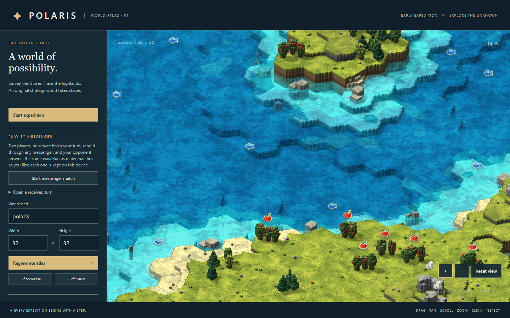

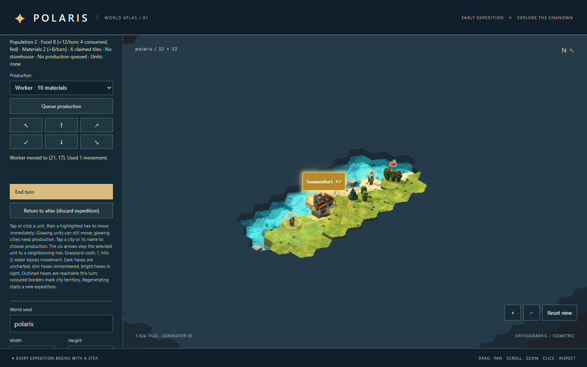

Captured from this implementation on desktop Chromium/SwiftShader, seed `polaris`, 32 × 32. The water picture is one frame of the animation; browser tests verify temporal pixel changes. The glows are static availability indicators. These are not reference artwork or native-device performance measurements.

**Zoom-dependent detail, up to 256 × 256:** the overview retains the economical 16/8/4/2 voxel densities, but zooming into larger maps now restores 4, 8 and ultimately 16 voxels per hex. Trees, rocks, sandbanks and underwater terraces regain their detailed geometry. The density follows the world-space viewport footprint, including aspect ratio and height clearance, rather than a fixed number of zoom clicks. The renderer keeps one padded, chunk-aligned window at a single density; its cut edges stay outside the view. It never builds the entire 256² world at showcase density. Existing chunks are reused while panning and departing chunks/textures are released. A hysteresis band avoids repeated rebuilds near a zoom threshold.

The canonical map, generator, saved games, visibility and simulation RNG do not change when zooming. Geometry noise and material shades stay globally anchored while the window moves. Picking, figures, city plates and resource annotations sample the active terrain density. Level changes are discrete: voxel-rounded ground and water heights can step when switching resolution, but there are no mixed-resolution seams inside the viewport. Meshing currently runs synchronously; entering a new density or crossing a window boundary can pause on slower devices, and a native-GPU smoothness claim requires device profiling. Diagnostics expose `voxelsPerTile`, `residentColumns` and cumulative `streamedChunks`. The hard domain/UI maximum remains **256 per side**, including imported maps.

### Visual overview: adaptive 256² detail

The same `polaris` 256 × 256 world in the running production build, desktop Chromium/SwiftShader at 1440 × 900. The overview uses density 2; the close view restores density 16, including apple voxels, stone deposits, fine ground shades and coastal terraces. These are fresh application captures, not a reference image or a frame-rate benchmark.

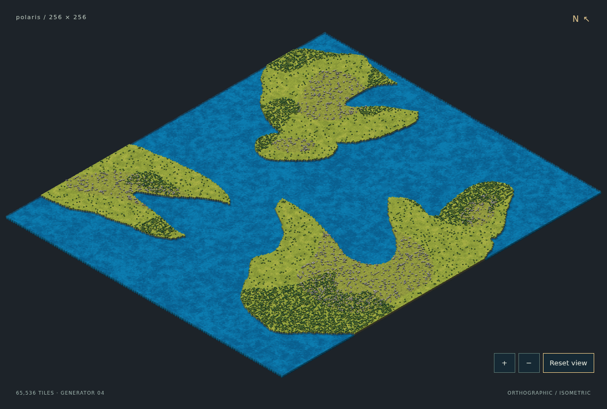

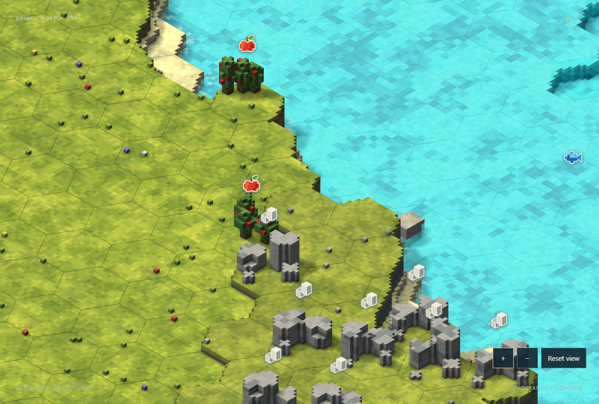

## Validation and benchmark evidence

The automated suite checks complete-map deterministic fingerprints for four seeds, continent separation and stepped elevation, dimensions/bounds and invalid inputs, real rendering/picking after pan/zoom/resize, HUD isolation, regeneration, and unavailable WebGL 2. Coast coverage verifies exactly four detailed seabed elevations and their coarse collapse, submerged and emerged rocks, cap coverage excluding solid footprints, opaque/transparent index separation, charted-only depth bands and sandbanks, chunk seams and full coastal invalidation. It also checks real sandbank height/area/irregularity, supported smaller trees, levelled settlements, brute-force agreement with actual-column picking, visible framebuffer sand/rock/water detail and canonical water picks on emerged rock. Resource checks cover deterministic terrain-appropriate occurrences, unchanged map/RNG data, real fruit/deposit geometry, dry sites, fog, city suppression, camera anchoring and bounded DOM nodes. Expedition coverage adds stable A*/Dijkstra paths, occupancy/costs, rejected commands, faction isolation, fog, actual UI movement/end-turn, hidden-terrain framebuffer/picking checks, mode-transition cleanup, city founding and its voxel settlement, economy inspection and production completion. Messenger coverage adds unit tests for replay, checksums and rejection of damaged, unfinished, tampered, foreign and repeated turns, plus the turn-code and storage adapters (several matches, migration, damaged entries), and browser tests in which two isolated browser contexts (separate storage, like two phones) exchange turns by link, pasted code and file, resume after a reload and leave a match, and one device keeps two matches and routes each received turn to its own match. Structural browser checks require **58 meshes / 6 materials / 58 geometries** for both the fine 32² atlas and the `polaris` 256² fixture (56 voxel chunks plus two hex markers), plus one shared `MultiMaterial`, not one object per tile. All three measured sizes must stay below 900,000 meshed vertices; the fine showcase deliberately replaces its former 250,000 ceiling. Expedition mode adds one small figure mesh per visible unit and shares the preallocated materials.

Three successive regenerations of **each** size retain those counts; the showcase also keeps its RNG state and vertex-buffer size. The disposal counter confirms 168 chunk meshes disposed for each fixture. `vertexBufferBytes` reports **chunk vertex/index arrays only**: 21,138,800 bytes (20.2 MiB, 422,776 vertices) for the showcase, 26,342,200 bytes (25.1 MiB, 526,844 vertices) at 64² and 16,828,200 bytes (16.0 MiB, 336,564 vertices) at 256². Generator-v4 coastlines and low connected terrain reduce geometry compared with the former per-hex hill domes; the fine showcase uses about 22% fewer vertices than the preceding coastal-resource pass. Coastal cap-colour boundaries split some greedy quads without adding meshes. These figures exclude the fixed 1024² shadow map (about 6 MiB: a 16-bit single-channel colour target plus 32-bit depth), the width × height RGBA tile-state texture and the voxel-column state texture, or CPU-side copies. Water adds at most one transparent draw per water-bearing chunk; the cap does not cast shadows. Rendering remains on demand. Materials persist across regenerations; full teardown disposes scene/engine, buffers, instrumentation, projected resource nodes and listeners. Stable resource counts demonstrate bounded scene resources, **not** a proof of absence of every browser/driver memory leak.

Use the revision's GitHub Actions checks for current type-check, lint, domain/browser test and production-build results. The historical map-only validation had 20 unit tests and 5 browser tests; those regression checks remain alongside the new expedition coverage. The historical benchmark below is not an expedition performance measurement. It also predates the voxel renderer: it measured generator 1 with thin-instance box terrain and has not been repeated for voxel chunks.

Measured results and reproduction details are recorded below. Architecture budgets are provisional targets, not acceptance claims for arbitrary hardware.

### Measured runner sample · 2026-11-05

[Raw measurements, including all 120 frame intervals per fixture](docs/benchmark.json). Production build at commit `2ab5ae7`; seed `polaris`, generator 1, Chromium **156.0.8078.4**, Linux **7.0.0-1017-azure**, Intel Xeon Platinum 8573C, 4 logical CPUs, 15.61 GiB RAM. Headless ANGLE/Vulkan **SwiftShader (Subzero)**, 1440 × 900 viewport, DPR 1; no physical GPU or controlled power profile. Another software-rendered browser was active during part of this sample, so CPU contention is a confounder.

| Actual measurement | 32 × 32 | 256 × 256 |
| --- | ---: | ---: |
| First generation / scene setup, ms | 1.1 / 111.4 | 9.8 / 375.9 |
| Five regenerations: generation median / max, ms | 0.3 / 2.5 | 11.4 / 12.1 |
| Five regenerations: scene setup median / max, ms | 11.3 / 13.4 | 355.1 / 3,186.0 |
| Idle frame intervals p50 / p95 / max, ms | 100 / 116.7 / 200 | 1,516.6 / 2,966.6 / 3,499.8 |
| 120-frame sample duration, seconds | 11.75 | 183.98 |
| Whole-map draw calls, markers hidden | 12 | 768 |
| Draw calls after four zoom/pan steps | 12 | 675 |
| Used JS heap snapshot, MiB | 27.21 | 41.87 |
| Estimated terrain vertex/index + matrix buffers, MiB | 0.072 | 4.615 |

**Method:** open each fixture with `?diagnostics=1`, wait two animation frames, record first timings; regenerate five times; warm up ten frames, then record 120 consecutive `requestAnimationFrame` timestamp differences. Percentiles use sorted sample indices 60 and 114 (approximate p50/p95); do not substitute Babylon's CPU-only `frameMs` for wall-clock frame intervals. Then perform four zoom-in/alternating-arrow-pan steps and sample draw calls/heap. Functional picks and three-regeneration disposal checks run separately in the browser suite. No unexpected console/page errors occurred in the benchmark.

Generation timing surrounds only pure `generateMap`; scene setup surrounds renderer construction/rebuilding and **does not measure first GPU presentation or time-to-interactive**. Heap is Chromium's `performance.memory.usedJSHeapSize` with `--enable-precise-memory-info`, a whole-page snapshot, not map-attributable memory or a forced-GC leak measurement. Buffer estimate is `matrix bytes + batch count × (24 vertices × 8 floats × 4 bytes + 36 indices × 2 bytes)`; it excludes driver copies, framebuffer, markers, JS objects, and allocator overhead. This is a lower-bound allocation estimate, not measured VRAM.

**Result and gap:** generation and structural batching work, but software-rendered frame pacing is poor, especially at 256². The fixture accepts pan/zoom/selection but is **not smoothly interactive on this runner**. The provisional frame targets are not met here; neither native GPU performance nor the full architecture benchmark protocol has been established. Follow up with an isolated Windows Chromium/Edge GPU benchmark, then profile vertex/draw cost and assess an overview LOD or chunk-size adjustment before expanding map sizes. A software-renderer result alone does not justify replacing Babylon with another engine.

**Reproduce:** run the validation commands above; then `npm run build` and `npm run preview`. Open either fixture with `&diagnostics=1`. Read-only `window.polarisDiagnostics.stats()`, `.camera()`, `.projectTile(id)` and `.expedition()` expose timing/resource/picking and player-view diagnostics only when explicitly requested. Unknown-tile projection uses the uniform fog surface, not its hidden elevation. `fogUpdates` counts tile-state updates (charted, explored or reachable tiles), allowing tests to prove camera motion does not recompute fog; `remeshedChunks` counts voxel chunks rebuilt after tiles become charted. For the frame sample, run in the browser console after warming up:

```js
const samples = [];
let last = await new Promise(requestAnimationFrame);
for (let i = 0; i < 120; i++) {
  const now = await new Promise(requestAnimationFrame);
  samples.push(now - last);
  last = now;
}
console.log({ samples, stats: window.polarisDiagnostics.stats() });
```

For CI-equivalent software measurements, use the Chromium flags documented above; add `--enable-precise-memory-info` only for heap reporting. Repeat on isolated hardware and report environment changes rather than comparing absolute times without context.

## Known limitations

- Only exploration, city founding and a production queue are playable. No combat, worker actions, research, policies, diplomacy, AI, general save/load, live multiplayer, physics, or external services.
- A solo expedition uses one faction and is lost when the page closes; only messenger matches are stored, in `localStorage` (see [Limits of a serverless match](#limits-of-a-serverless-match)). Drawing founders and units, remembered (last-known) rival cities, hidden enemy units and mutable last-known terrain belong to later milestones.
- Only Chromium is automated; phone viewports and touch input run as Chromium emulation. Windows Edge hardware, Firefox/Safari, real Android/iOS devices and mobile GPUs, long-duration profiling, assistive-technology map navigation, and WebGPU are unvalidated/deferred.
- Continents and tree clusters are seeded procedural shapes, not a climate or hydrology simulation; rivers and bridges are not yet represented. At full stress-map zoom tiles are intentionally tiny; zoom in to inspect them.
- Voxel chunk meshing, scene upload and remeshing after exploration run synchronously on the main thread; switching to the 256² fixture takes about 2 seconds under SwiftShader. Large-map interactions must be profiled before promising larger maps. The 256² fixture is not a finished-game performance promise.
- The recorded SwiftShader 256² frame intervals are seconds, not a smooth-play claim; native GPU validation and focused rendering profiling remain open.
- Babylon's initial bundle is substantial; Vite reports a chunk-size advisory. It is not a build failure. Loading/code-splitting optimization is deferred until measured.

## Dependencies, assets, and licensing

Runtime: Babylon.js (`@babylonjs/core`, Apache-2.0). Tooling: Vite, Vitest, ESLint, typescript-eslint and Node type definitions (MIT); TypeScript and Playwright (Apache-2.0). Exact package versions and transitive license metadata are in `package-lock.json`; full notices/licenses are included in installed packages and must be retained as required when distributing dependencies.

The minimatch override pins a patched release for the lint toolchain's transitive denial-of-service advisory, GHSA-g3hv-75wg-m249. Re-evaluate the override with future lint-tool upgrades; do not silently restore the vulnerable resolution.

All map geometry, CSS, SVG concept art, favicon, and screenshot are original procedural/code-created placeholders. No reference-game code, names, maps, text, music, art, paid assets, generated artwork, or remote fonts are used. System fonts only. Blockbench (cuboid models) and Blender (cleanup/glTF pipeline) are optional future authoring tools, never setup dependencies. No inspector is bundled; use browser developer tools now and verify a development-only inspector integration in a later task.

**No license is selected for Polaris's own source or assets.** That decision belongs to the repository owner; dependency licenses do not license this game.
